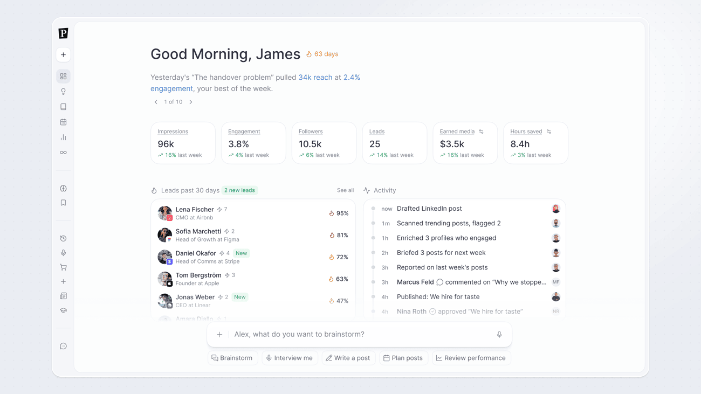

The Dashboard is your Pressmaster home, built to orient you immediately and get you into action fast. It shows your last seven days of performance, people worth following up with, what's coming up next on your calendar, and a chat bar so you can start working without opening a separate creation flow.

## What's on your Dashboard

### Your last 7 days

A snapshot of your performance over the past week, impressions, engagement, followers, and other core metrics, so you can see at a glance whether the week is trending up or down before digging into the full [Performance](/performance/overview) view.

### Follow-up contacts

People from your identified leads who are worth following up with now, pulled from [Leads](/performance/leads). Click through to see the full list and move them along your pipeline.

### Upcoming posts

Your next scheduled posts, pulled from the [Calendar](/calendar/overview), so you can see what's about to go out without leaving the Dashboard.

### Chat bar

A chat bar at the bottom of the Dashboard lets you start working immediately:

- **Brainstorm**, explore and develop ideas through chat
- **Interview me**, launch an interview on any topic instantly
- **Write a post**, create a single ready-to-post piece right now
- **Plan posts**, build a full content plan for the week or month
- **Review performance**, jump straight into your latest results

## Demo data for new workspaces

New workspaces show demo data on the Dashboard so you can see what it looks like with real activity. Demo data stays in place until you create your own content or turn on Leads, whichever comes first, then it's replaced with your real numbers.

## Getting the most from your Dashboard

The Dashboard reflects the quality of your setup. The more complete your [IdentityOS](/knowledge/identityos) and the more channels you have connected, the more accurate and useful your performance snapshot and follow-up contacts will be.

<Tip>
  Check your Dashboard each morning, your 7-day performance view and follow-up contacts give you a clear starting point for the day.
</Tip>
