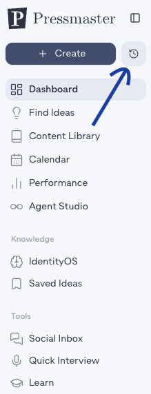

Chat History gives you a dedicated place to find and resume past conversations with your agents, instead of scrolling back through the chat panel itself.

## Opening Chat History

Click the clock icon next to **+ Create** at the top of the sidebar to open Chat History from anywhere in Pressmaster.

## Finding a conversation

Use the search field to find a past conversation by keyword, no need to remember exactly when it happened or which agent you were talking to.

## Needs your approval

A **Needs your approval** section surfaces conversations with pending approvals, each shown with a badge so you can see at a glance how many items in that conversation are waiting on you. Click through to review and approve or reject directly.
