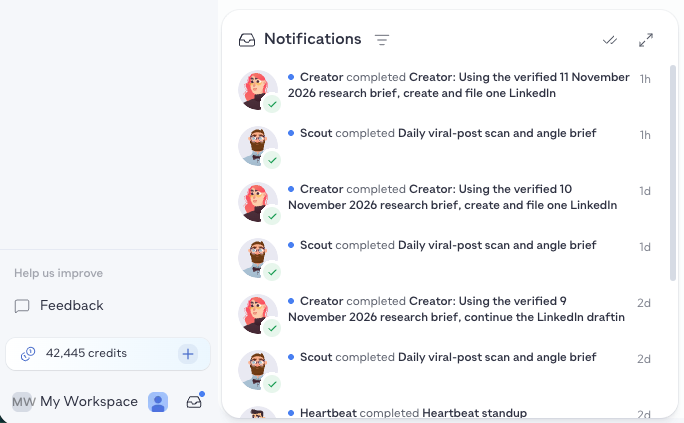

Notifications is Pressmaster's in-app notification center, a single place to see everything that needs your attention across the platform, without hunting through each section individually.

## Reading an entry

Each entry shows the avatar of the agent or source it came from, who did what (for example, "Creator completed Creator: Using the verified 11 November 2026 research brief, create and file one LinkedIn"), a checkmark once it's done, and how long ago it happened.

## Using the panel

From the header, click the double-checkmark icon to mark everything as read, or the expand icon to open Notifications in a full page instead of the panel.

## What shows up in Notifications

Notifications collects updates across categories:

- **Comments**, new comments on your published posts
- **Approvals**, content and agent actions waiting for your review
- **Agent tasks**, updates on tasks your agents have run, completed, or flagged
- **Publishing**, confirmations and failures for scheduled and published content
- **Performance signals**, notable changes in your metrics worth knowing about
- **Account alerts**, billing, credits, and connection issues that need action

## Announcements

Announcements is a separate category inside Notifications for updates from the Pressmaster team, new features, changes to existing ones, and other platform news, kept apart from your workspace's own activity so the two don't get mixed together.

<Tip>
  Check Notifications regularly so approvals and account alerts don't sit unresolved, items like a disconnected channel or a pending approval can block other work until you act on them.
</Tip>
