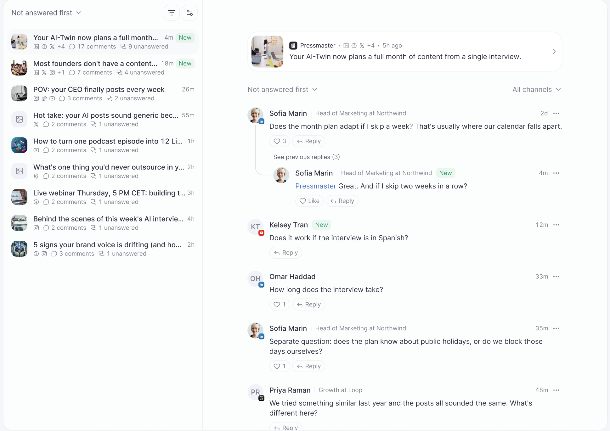

Social Inbox is a page under **Tools** that collects the comments on your posts from all connected profiles and channels in one list. Reply, like, hide, and delete comments without leaving Pressmaster, and let AI draft replies in your voice.

<Note>
  Social Inbox shows only posts published through Pressmaster. Posts published directly on a social network aren't included. Every action you take (reply, like, hide, delete) is applied on the social network itself, not only inside Pressmaster.
</Note>

## Getting started

The first time you open Social Inbox, a short setup asks two questions. Your answers become your Social Inbox settings, and you can change them later.

<Steps>
  <Step title="Choose whether to draft replies">
    Choose **Draft every reply** (recommended) or **No drafts**.
  </Step>
  <Step title="Choose how replies are written">
    Choose **Best practices** (recommended) or **Custom guidelines**. Custom guidelines is a text field where every line is one guideline, these lines are the rules the AI follows when it writes a reply.
  </Step>
  <Step title="Open the inbox">
    Click **Open inbox**.
  </Step>
</Steps>

If you have no connected channel yet, you see **Connect a channel to see comments** with a **Connect channels** button instead of the inbox. Setup always comes first, you answer the questions and click **Open inbox** before this screen appears. After you connect a channel and return to Social Inbox, the inbox opens right away without a page refresh.

## The inbox

The inbox lists the posts you published through Pressmaster on all connected profiles and channels. Each post shows its number of comments and how many are unanswered, new comments are marked **New**.

- **Post titles**, a post is titled with the first sentence of its text, the same as in Content Library and the Calendar. "Untitled post" appears only when the post has no text.
- **Previews**, posts with a video show a preview image of the video. If no preview is available, a grey image placeholder is shown, as for posts without media.
- **Sorting**, choose **Not answered first**, **Newest first**, or **Oldest first**.
- **Filtering**, filter by profile and by channel. If nothing matches, you see "Nothing here" and can clear the filters. On a phone, sorting and filtering are in the **Sort and filter** menu, which opens from the bottom of the screen.
- **Loading**, while the list loads, you see placeholder skeletons.

## Comments and threads

Open a post to see its comments and replies. You can switch between **All channels** and a single channel, and sort the comments. Long reply chains are collapsed behind **See previous replies**. Click the post header to open the post details.

<Note>
  **Thread posts on Threads and X**: if you published a post split into several parts, the parts aren't shown as comments or replies. A comment left on any part of the thread appears as a comment on the post, and the counts match what's shown.
</Note>

<Note>
  A comment that contains only an image or GIF and no text may not display its media. This is a known limitation of the service that delivers comments to Pressmaster.
</Note>

## Actions on a comment

Use the menu on a comment. Every action is applied on the social network itself.

| Action | Where it works | Notes |
|---|---|---|
| Like or unlike | Channels that support it | If a channel doesn't support an action, you see "This channel doesn't support that action." |
| Open the commenter's profile | All channels | Opens their profile on the social network |
| Hide or unhide | Facebook, Instagram, X, Threads, TikTok | Hidden comments can be unhidden |
| Delete | All channels | Asks for confirmation first |

## Replying to comments

Click **Reply** on a comment, then type your reply or let AI write it.

**Draft with AI** writes a reply in your voice, following your settings and your custom guidelines (or best practices). It uses the comment, the post, and the thread as context. The AI never invents a name, if the commenter has only a handle, the draft uses no name or uses the handle.

If **Draft every reply** is on, a draft is prepared automatically for every new comment. When you click **Reply**, the draft is already in the reply box, so you only review, edit, and send. Automatic drafts are limited to 200 per workspace per day.

**Rewrite with AI** becomes available once there's text in the reply box, and offers these options:

- Shorter
- Longer
- Friendlier
- More professional
- Ask a question back
- Try another version
- Your own instruction ("Tell AI what to change")

The option you pick always wins over your settings, just for that one reply. For example, "Ask a question back" returns a reply with one question even if your settings say not to ask questions. The new version can be used (replacing your text), kept aside, retried, or copied. **Retry** gives a different version. If the AI can't produce anything different, you're told so and no credits are charged.

## Character limits

The reply box shows a character counter with the limit of the channel. While the text is over the limit, **Send** stays disabled and you need to shorten the text yourself.

| Channel | Limit |
|---|---|
| LinkedIn | 1,250 |
| Facebook | 8,000 |
| Instagram | 2,200 |
| X | 280 |
| Threads | 500 |
| YouTube | 10,000 |
| TikTok | 150 |

## Tagging people

On LinkedIn, a reply tags someone only when you paste a LinkedIn profile or company link into the reply box. On other channels, a typed `@handle` may stay plain text, depending on the network.

## After you send

A sent reply appears in the thread marked "Sent by you", or with the name of the team member who sent it. If the send fails, the reply shows "Couldn't post to \<channel\>" with **Retry** and **Discard**. The cases below show a more specific message.

| Situation | What you see |
|---|---|
| The comment was deleted on the social network | "This comment no longer exists." Only **Discard** is offered, because Retry can't work. |
| The channel is disconnected | The post shows "\<Channel\> disconnected" with **Reconnect**, and the reply box is locked with "\<Channel\> is disconnected. Reconnect it to send replies." |
| The channel disconnects while you type | The failed reply says to reconnect the channel, with a **Reconnect** button instead of Retry. |
| Too many requests to the AI model | "Too many requests right now. Please try again in a minute." Nothing is charged. |
| Any other error | "Something went wrong. Please try again." |

## Delete or edit your own reply

Open the menu on your own reply. You can delete it on every channel. You can edit it on LinkedIn, Facebook, and YouTube. Instagram, X, Threads, TikTok, and Bluesky don't offer Edit.

## Settings, credits, and disconnected channels

### Settings

Open the settings menu inside the inbox to change what you chose in setup:

- Turn **Draft every reply** on or off.
- Switch between **Best practices** and **Custom guidelines**. Custom guidelines are edited in a dialog, one guideline per line. Choosing Best practices clears your saved guidelines.
- Turn Social Inbox off or on. When it's off, you see the "Social Inbox is off" state.

Reply length, asking a question back, emoji use, and spam handling are no longer settings, use the Rewrite options to change a single reply.

### Credits

| Action | Cost |
|---|---|
| Draft with AI | 10 credits |
| Rewrite with AI | 10 credits, not charged when the result is the same text |
| Automatic draft (Draft every reply) | 10 credits each, up to 200 per workspace per day |
| Sending, liking, hiding, deleting | Free |
| Reading a draft the inbox already made automatically | Free |

A failed or rate-limited generation is not charged. Agent Studio and the Pressmaster MCP follow the rules in the next section.

### Disconnected channels

If a channel is disconnected or its connection expired, the posts of that channel show "\<Channel\> disconnected" with a **Reconnect** button. Replies on that channel are blocked until you reconnect.

## Social Inbox with Agent Studio and the Pressmaster MCP

Both the Agent Studio agent and the Pressmaster MCP (the connection Claude, ChatGPT, and ClickUp use) work on the same inbox you see in Pressmaster: the same comments, the same reply rules, the same channel limits. Both need Social Inbox to be switched on, setup to be completed, and at least one channel to be connected, otherwise they return a message naming the reason. Settings and the first-visit setup can only be changed on the page.

### Agent Studio

You can ask the agent, for example, "what did people comment on my posts this week, draft replies in my voice and send the ones I approve." You can also set it as a recurring task, such as every weekday morning, with the existing scheduling. A new comment doesn't start an agent run by itself.

The agent can read the inbox and threads, save a draft on a comment, send a reply, like, hide, delete a comment, and delete your own reply.

- **Approval**, sending a reply follows your workspace autonomy tier, like publishing a post. In a supervised workspace, every reply is reviewed before it's sent.
- **Credits**, the agent has no paid draft tool. It writes replies itself, so only normal agent usage applies and no Social Inbox credits are charged.
- **In the inbox**, a reply sent by the agent shows that it was sent by the agent, never "Sent by you". A draft saved by the agent shows "Prepared by your agent". You can send, edit, or discard it on the page.
- **Activity log**, the agent activity log records comment and post IDs only, never commenter names or comment text.

### Pressmaster MCP

In Claude, ChatGPT, or ClickUp with the Pressmaster MCP connected, you can list the posts with unanswered comments, read a thread, get a reply brief or a Pressmaster-written draft, send a reply, like, hide, or delete, and read or change the reply preferences. The result is the same as doing it on the page.

<Warning>
  There's no approval step over MCP. A call runs immediately, a reply is posted publicly, and hide and delete take effect right away, so check before you confirm in your AI tool.
</Warning>

- **Credits**, draft and rewrite over MCP cost 10 credits each, like on the page, and show in the workspace usage history. A retried request with the same request ID is never billed or posted twice. An exhausted balance is reported as such.
- **Who sent it**, a reply sent through MCP appears in the thread as sent by the person whose MCP connection made the call.
- **Permissions**, role rules mirror the page and are stricter for member roles. Social Inbox tools are available only to eligible workspaces and plans.
- **Limits**, lists and threads are paginated and never return unlimited comments.

## Troubleshooting and FAQ

<AccordionGroup>
  <Accordion title="Why don't I see a comment from one of my posts?">
    Social Inbox shows only posts published through Pressmaster. Posts published directly on a social network aren't included. Also check that the channel is still connected.
  </Accordion>

  <Accordion title='Why do I see "Connect a channel to see comments"?'>
    No channel is connected to this workspace. Click **Connect channels** and connect at least one, then return to Social Inbox.
  </Accordion>

  <Accordion title="Why is the Send button disabled?">
    Your reply is over the character limit of the channel. Shorten the text until the counter is back within the limit.
  </Accordion>

  <Accordion title="Why does my reply say Couldn't post?">
    The social network refused the reply. Click **Retry** for a temporary problem. If the comment was deleted, the message says so and you can only discard the reply. If the channel is disconnected, reconnect it first.
  </Accordion>

  <Accordion title="Why was I charged credits for an AI reply?">
    Draft with AI, Rewrite with AI, and automatic drafts cost 10 credits each. A rewrite that returns the same text isn't charged. Sending, liking, hiding, and deleting are free.
  </Accordion>

  <Accordion title="Why can't I edit my reply on Instagram, X, Threads, TikTok, or Bluesky?">
    Editing is available on LinkedIn, Facebook, and YouTube only.
  </Accordion>

  <Accordion title='I deleted a reply on YouTube, but YouTube still shows "1 reply."'>
    The reply is removed. The old counter is on YouTube's side and updates later.
  </Accordion>

  <Accordion title="Why can't I hide a comment on LinkedIn or YouTube?">
    Hiding is available on Facebook, Instagram, X, Threads, and TikTok. On other channels, you can delete the comment.
  </Accordion>

  <Accordion title="Why is a comment with an image empty?">
    Comments that contain only media may not display it. This is a known limitation of the service that delivers comments to Pressmaster.
  </Accordion>

  <Accordion title="Does a new comment make the agent reply on its own?">
    No. The agent works when you ask it or on a schedule you set.
  </Accordion>

  <Accordion title="Can I turn Social Inbox off?">
    Yes. Use the settings menu in the inbox. You can turn it on again at any time.
  </Accordion>
</AccordionGroup>
